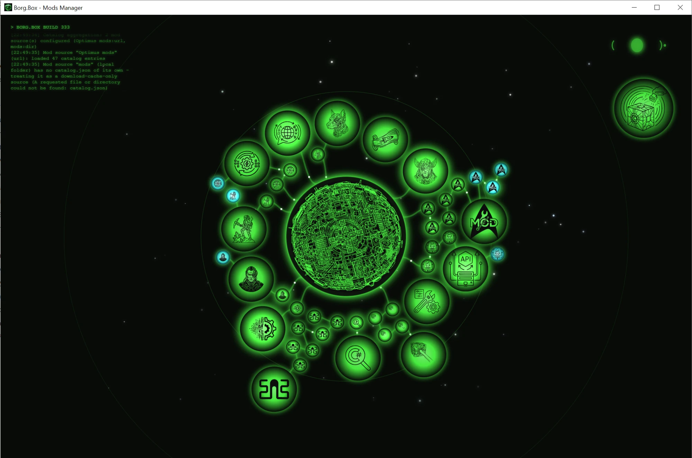

# Borg.Box

[English](#english) | [Русский](#русский)

---

## English

**Borg.Box** is a mod manager for *Star Trek Fleet Command™*'s [BepInEx](https://github.com/BepInEx/BepInEx) modding ecosystem, presented as a Borg-themed neural tree interface. It's a native Windows desktop app built with [Tauri](https://tauri.app/).



### What it does

- Visualizes the mod catalog as a branching neural tree around a central hub: each branch is a mod, each node on the branch is a version, the outermost (largest) node is the current/latest version.
- Prepares a dedicated copy of the game client for mods — the original install is never touched.
- Installs, updates, and removes signed `.mod` packages directly into that copy — no manual file copying.
- Verifies package signatures and file hashes before installing anything.
- Optional hub setting hides older mod versions so the tree stays lighter and an update is easier to spot and click.
- Backs up the modified client folder to a full zip (the file name includes the client version), keeps a log of those backups, and restores a selected archive back into the copy folder.
- Lets you add extra mod sources (a `catalog.json` URL or a local folder) alongside the default one — [stfc-mod-source](https://github.com/Plurimus/stfc-mod-source), a curated catalog of signed BepInEx mods for STFC.
- Includes an in-app **assembly module** to build and sign your own `.mod` packages (manifest editor, DLL metadata reading, changelog/screenshots, key generation).
- Full UI in 10 languages: English, Russian, German, Italian, French, Spanish, Portuguese, Korean, Chinese, Japanese.
- Writes files with native Rust I/O, so it isn't limited by the browser's File System Access API restrictions on installing `.dll`/`.exe` files (the reason this is a desktop app and not a plain web page).

### Download

Grab the latest release from the [Releases](../../releases) page:

- **Portable** (`Borg.Box-portable-*.zip`) — unzip and run `Borg.Box.exe`, no installation needed.

### Building from source

Requires [Node.js](https://nodejs.org/) and [Rust](https://www.rust-lang.org/tools/install) (`rustup`).

```bash
npm install
npm run dev     # run in development mode (does not bump the version)
npm run build   # bump the patch version, then produce the release exe + NSIS/MSI installers
```

GitHub releases ship the portable zip. `npm run build` also writes Windows installer packages locally (`src-tauri/target/release/bundle/`).

The actual frontend (plain JS/SVG, no framework) lives in [`Borg.Box/`](Borg.Box/) — see [`Borg.Box/README.md`](Borg.Box/README.md) for how it's built on top of the [borg-html-sdk](https://github.com/JBlond/borg-html-sdk) (MIT-licensed) neural tree demo. [`src-tauri/`](src-tauri/) is the native wrapper that gives that frontend real filesystem access, including client-folder copy, backup, and restore.

### Support

For STFC BepInEx items and Borg.Box support, please visit the [BORG Box](https://discord.gg/8MRcfserGH) Discord server.

---

## Русский

**Borg.Box** — менеджер модов для экосистемы [BepInEx](https://github.com/BepInEx/BepInEx) в *Star Trek Fleet Command™*, оформленный в виде борговского нейронного дерева. Нативное десктопное приложение под Windows на [Tauri](https://tauri.app/).


### Что умеет

- Показывает каталог модов в виде дерева ветвей вокруг центрального хаба: каждая ветка — мод, каждый узел на ветке — версия, самый крайний (большой) узел — текущая/последняя версия.
- Готовит отдельную копию клиента для модов — оригинальная установка не трогается.
- Устанавливает, обновляет и удаляет подписанные `.mod`-пакеты прямо в эту копию — без ручного копирования файлов.
- Проверяет подписи пакетов и хэши файлов перед установкой.
- Опциональная настройка хаба скрывает старые версии модов, чтобы дерево было легче и обновление было проще заметить и нажать.
- Делает полный zip-бэкап папки-копии клиента (в имя файла добавляется версия клиента), ведёт журнал этих бэкапов и восстанавливает выбранный архив обратно в копию.
- Позволяет добавлять дополнительные источники модов (ссылку на `catalog.json` или локальную папку) в дополнение к основному — [stfc-mod-source](https://github.com/Plurimus/stfc-mod-source), подобранному каталогу подписанных BepInEx-модов для STFC.
- Включает встроенный **модуль сборки** для создания и подписи собственных `.mod`-пакетов (редактор манифеста, чтение метаданных из DLL, changelog/скриншоты, генерация ключей).
- Полный интерфейс на 10 языках: русский, английский, немецкий, итальянский, французский, испанский, португальский, корейский, китайский, японский.
- Записывает файлы через нативный Rust-код, поэтому не упирается в ограничение File System Access API браузера на установку `.dll`/`.exe` файлов (из-за этого ограничения приложение и сделано десктопным, а не веб-страницей).

### Скачать

Последний релиз — на странице [Releases](../../releases):

- **Портативная версия** (`Borg.Box-portable-*.zip`) — распакуйте и запустите `Borg.Box.exe`, установка не нужна.

### Сборка из исходников

Нужны [Node.js](https://nodejs.org/) и [Rust](https://www.rust-lang.org/tools/install) (`rustup`).

```bash
npm install
npm run dev     # режим разработки (версию не поднимает)
npm run build   # поднимает patch-версию, затем собирает релизный exe + установщики NSIS/MSI
```

В GitHub-релизах выкладывается портативный zip. `npm run build` также собирает установщики Windows локально (`src-tauri/target/release/bundle/`).

Сам фронтенд (чистый JS/SVG, без фреймворков) лежит в [`Borg.Box/`](Borg.Box/) — см. [`Borg.Box/README.md`](Borg.Box/README.md) о том, как он построен поверх демо [borg-html-sdk](https://github.com/JBlond/borg-html-sdk) (лицензия MIT). [`src-tauri/`](src-tauri/) — нативная обёртка, дающая тому же фронтенду настоящий доступ к файловой системе, включая копирование клиента, бэкап и восстановление.

### Поддержка

По вопросам модов STFC BepInEx и Borg.Box — сервер Discord [BORG Box](https://discord.gg/8MRcfserGH).
